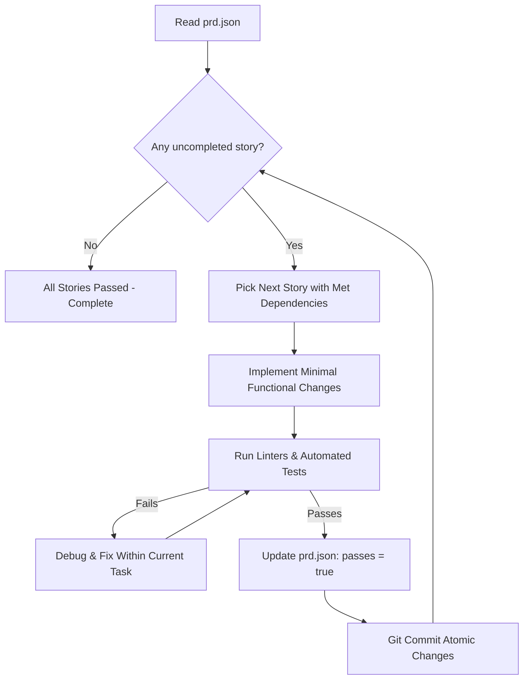

# Ralph Loop - Autonomous Iterative Execution System

The **Ralph Loop** (Ralph Wiggum pattern) is an autonomous agent architecture designed for long-running, multi-step engineering tasks. Instead of overloading a single conversation context with an entire project, Ralph executes short, self-contained **Plan → Act → Check** iterations where progress is persisted in the repository rather than in transient LLM memory.

---

## Core Principles

1. **Atomic Story Size (The Golden Rule)**:
   - Each story or task **must** be completable within **a single iteration/context window**.
   - If a task involves schema changes, API endpoints, and frontend screens, decompose it into sequential subtasks:
     1. Database migration & model definition
     2. Service layer & backend logic
     3. API endpoint & validation
     4. UI components consuming the API
     5. End-to-end integration & verification

2. **Strict Dependency Ordering**:
   - Order stories so prerequisites are always completed before consumers:
     `Schema / Data Models ➔ Core Logic / Services ➔ APIs ➔ UI Components ➔ Integration & Polish`

3. **Verifiable Definition of Done**:
   - Every story must specify unambiguous acceptance criteria:
     - Automated test execution (`flutter test`, `pytest`, `npm test`)
     - Typecheck & static analysis (`dart analyze`, `ruff check`, `tsc`)
     - Clean git working tree with an atomic commit

4. **Zero Context Bleed**:
   - Task status is saved directly in `prd.json` or `progress.txt`.
   - Work is committed after each iteration: `git commit -m "feat(scope): US-00X task description"`.

---

## State Format: `prd.json`

Ralph uses a structured task tracking file at the root of the project:

```json
{
  "projectName": "bloodpulse",
  "branchName": "ralph/feature-name",
  "updatedAt": "2026-10-29T03:30:00Z",
  "stories": [
    {
      "id": "US-001",
      "title": "Add blood donor eligibility endpoint",
      "dependencies": [],
      "acceptanceCriteria": [
        "Django view validates last donation interval >= 90 days",
        "Unit tests pass with >90% coverage",
        "Ruff and mypy pass without errors"
      ],
      "passes": false,
      "notes": ""
    },
    {
      "id": "US-002",
      "title": "Integrate donor eligibility card on Blood Hub",
      "dependencies": ["US-001"],
      "acceptanceCriteria": [
        "Eligibility card reflects backend status",
        "Flutter widget tests pass",
        "dart analyze passes"
      ],
      "passes": false,
      "notes": ""
    }
  ]
}
```

---

## Iteration Execution Lifecycle

In each Ralph iteration:



### 1. Read and Select
- Read `prd.json`.
- Find the first story where `passes: false` and all IDs in `dependencies` have `passes: true`.

### 2. Implement
- Make minimal, clean changes strictly required for the selected story.
- Follow project conventions, design tokens, and existing patterns.

### 3. Verify
- Run linting and typecheck tools.
- Run targeted automated unit and widget tests.
- Verify zero regressions.

### 4. Commit and Advance
- Update `prd.json` setting `passes: true` and document any key notes.
- Create an atomic git commit:
  ```bash
  git add <modified-files> prd.json
  git commit -m "feat(scope): complete US-XXX description"
  ```

---

## Antigravity Execution Modes

### Mode A: Interactive Agent Session
Ask the agent:
> "Run Ralph Loop on `prd.json`" or "Convert this requirements list into Ralph format and begin iterations."

The agent will execute one task at a time, verify, commit, and report progress.

### Mode B: Antigravity Slash Command `/goal`
For extended unattended runs, recommend the `/goal` slash command:
```text
/goal Execute all tasks in prd.json following the Ralph Loop skill, verifying and committing after each task until complete.
```

### Mode C: Automated Script Loop (CLI / Headless)
If running automated scripts outside the UI:

```powershell
# Windows PowerShell Ralph Loop Runner
while ($true) {
    $prd = Get-Content "prd.json" | ConvertFrom-Json
    $pending = $prd.stories | Where-Object { $_.passes -eq $false }
    if (-not $pending) {
        Write-Host "All Ralph tasks completed successfully!" -ForegroundColor Green
        break
    }
    Write-Host "Starting next Ralph iteration..." -ForegroundColor Cyan
    # Invoke agent CLI or runner here
}
```
